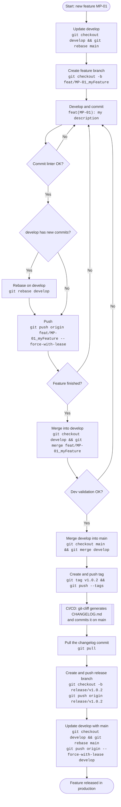

# Gitflow

Here is the documentation for Gitflow and commit usage.

## Commit message

The [commit linter](./COMMITLINT.md) expects a commit format convention inspired by [conventionalcommits.org](https://www.conventionalcommits.org/en/v1.0.0/).

#### Example:

A commit must use the following format:

    <type>(scope): <description>

For a feature:

    feat(MP-01): init my awesome project

And for a bugfix:

    fix(MP-02): my fix

## Changelog generation

[Cliff](./CLIFF.md) generates the changelog automatically based on commits (that's why the commit linter is important).

On each tag, Cliff computes the diff with the previous version and adds the new features, classified by `<type>`.

We recommend setting up automatic changelog generation when pushing tags.

#### Tag creation:

    git tag v1.0.1

#### Push tags to the remote:

    git push --tags

See the [official Git documentation](https://git-scm.com/docs/git-tag) on tags.

## CI/CD tag documentation

Here are some examples of CI/CD configuration for automatic changelog generation when pushing tags.

#### Bitbucket

```yaml
image: alpine/ansible:2.17.0

definitions:
  steps:

    - step: &generate-changelog
        name: Mise à jour du CHANGELOG
        image: node:24
        clone:
          depth: full        # git-cliff a besoin de tout l'historique + les tags
        script:
          # On se place sur main (le build tag démarre en HEAD détachée)
          - git fetch origin ${BITBUCKET_BRANCH}
          - git checkout ${BITBUCKET_BRANCH}
          - npm install -g pnpm@latest-11
          # Régénération du changelog (le tag poussé est déjà dans l'historique)
          - pnpm dlx git-cliff@2.13.1 -o CHANGELOG.md
          # Re-commit sur main uniquement si le fichier a changé
          - |
            if git diff --quiet -- CHANGELOG.md; then
              echo "CHANGELOG.md déjà à jour, rien à committer."
            else
              git config user.name "Bitbucket Pipeline"
              git config user.email "pipeline@uxco-group.com"
              git add CHANGELOG.md
              git commit -m "docs(changelog): mise à jour pour la branche ${BITBUCKET_BRANCH}"
              git push origin HEAD:${BITBUCKET_BRANCH}
            fi

    - step: &generate-changelog-on-tag
        name: Mise à jour du CHANGELOG au push sur le tag ${BITBUCKET_TAG}
        image: node:24
        clone:
          depth: full        # git-cliff a besoin de tout l'historique + les tags
        script:
          # On se place sur main (le build tag démarre en HEAD détachée)
          - git fetch origin main
          - git checkout main
          - npm install -g pnpm@latest-11
          # Régénération du changelog (le tag poussé est déjà dans l'historique)
          - pnpm dlx git-cliff@2.13.1 -o CHANGELOG.md
          # Re-commit sur main uniquement si le fichier a changé
          - |
            if git diff --quiet -- CHANGELOG.md; then
              echo "CHANGELOG.md déjà à jour, rien à committer."
            else
              git config user.name "Bitbucket Pipeline"
              git config user.email "pipeline@uxco-group.com"
              git add CHANGELOG.md
              git commit -m "docs(changelog): mise à jour pour ${BITBUCKET_TAG} [skip ci]"
              git push origin HEAD:main
            fi

pipelines:
  # Déclenché automatiquement au push d'un tag de version (ex : v1.2.3).
  # Régénère CHANGELOG.md via git-cliff puis le re-commit sur main.
  tags:
    'v*':
      - step: *generate-changelog-on-tag

  custom:
    generate-changelog:
      - step: *generate-changelog
```

#### GitHub workflow

```yaml
name: release

on:
  push:
    tags:
      - 'v*'

permissions:
  contents: write
  packages: write

jobs:
  changelog:
    needs: test
    runs-on: ubuntu-latest
    steps:
      - uses: actions/checkout@v4
        with:
          ref: main
          fetch-depth: 0
          token: ${{ secrets.GITHUB_TOKEN }}

      - name: Generate changelog
        uses: orhun/git-cliff-action@v4
        with:
          config: cliff.toml
          args: --bump -o CHANGELOG.md

      - name: Commit and push changelog
        run: |
          git config user.name "github-actions[bot]"
          git config user.email "github-actions[bot]@users.noreply.github.com"
          git add CHANGELOG.md
          git diff --cached --quiet && echo "No changes" && exit 0
          git commit -m "docs(release): update CHANGELOG.md [skip ci]"
          git push origin HEAD:main

```

Workflow permissions can be edited on GitHub in Settings → Actions → General → Workflow permissions.

## BRANCH NAMING CONVENTION

All dev branches should be named using the format `<type>/<scope>_<description>`.
The description must be in camelCase.

#### Example:

```text

    feat/MP-01_myAwesomeFeatures
    bugfix/MP-02_myCriticalBugfix

```

## GITFLOW

We have multiple branches.

#### main: final branch that receives all features

It never directly receives work done on a feature branch.

Example:

We never run `git merge feat/MP-01_myFeatures` on main.

Main is always updated by merging develop:

```shell
    git merge develop
```

#### develop: final branch for developers

Receives all the work done by the other devs through merges:

```shell
    git merge feat/TW-01_myAwesomeFeatures
```

#### Feature branches:

Each developer creates a new branch for their own features.
This branch should always be up to date with develop, and develop should always be up to date with main.

All branch updates should be done by rebase.

#### Example

```shell
    main -> develop : 
        git checkout develop && git rebase main 
    
    develop ->  feat/MP-01_myFeatures: 
        git checkout feat/MP-01_myFeatures && git rebase develop
```

To push a branch after a rebase, use the `--force-with-lease` option:

```shell
    git push origin feat/MP-01_myFeatures --force-with-lease
```

All dev validation should be done through merges.

#### Example

```shell
    feat/MP-01_myFeatures -> develop : 
        git checkout develop && git merge feat/MP-01_myFeatures

    develop -> main : git checkout main && git merge develop
```

## DEPLOYMENT

To deploy to production, create a tag with your new version, push it, and create a release branch named after the new tag version.
This makes it easy to roll back, keeps a history of your work, and lets you choose which specific work can be released (with a cherry-pick, for example).

Example:

```shell

    ## I switch to main branch
    git checkout main

    ## I create my tag locally
    git tag v1.0.2

    ## I push my tag to the remote
    git push --tags

    ## I wait for the changelog generation CI/CD and pull the pipeline commit
    git pull

    ## Once the commit is local, I create my release branch
    git checkout -b release/v1.0.2

    ## I push my release branch to the remote
    git push origin release/v1.0.2

    ## I update my develop branch with the changelog commit from main to avoid future conflicts
    git checkout develop
    git rebase main
    git push origin --force-with-lease develop

```


## FEATURE LIFECYCLE

Full workflow of a feature, from branch creation to production release:


